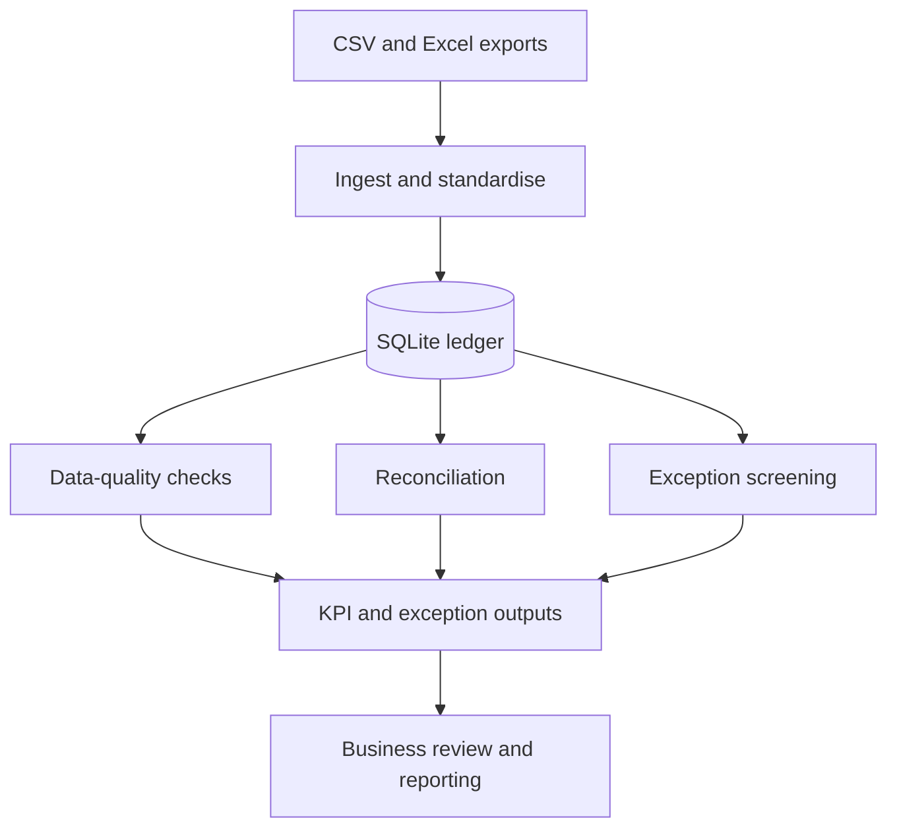

# Transaction Data Quality & Reconciliation

A data analytics portfolio project exploring how mixed financial transaction exports can be validated, standardised, reconciled, and turned into actionable exception reports.

**Tools:** Python · SQL · SQLite · pandas · Excel/CSV · pytest · Power BI (reporting extension)

> **Project status:** Initial baseline imported for study and improvement. The next stage is to validate the pipeline, reproduce its outputs, document findings, and add original analysis and improvements.

## Business problem

Finance and operations teams often receive transaction data from multiple systems in inconsistent formats. Missing fields, invalid vendor references, duplicate-payment candidates, and differences between ledger totals and control totals can reduce confidence in reporting.

This project demonstrates an analytical workflow for surfacing those issues so a reviewer can investigate them. The included records are described as synthetic demonstration data, not transactions from a real company.

## What the project covers

| Area | Analysis |
|---|---|
| Data ingestion | Read transaction exports from CSV and Excel files |
| Standardisation | Clean and prepare records for analysis in SQLite |
| Data quality | Check required fields, transaction ID uniqueness, and vendor references |
| Reconciliation | Compare ledger totals with supplied control totals using a configurable tolerance |
| Exception screening | Identify duplicate-payment candidates and unusual first-digit distributions for review |
| Reporting | Produce KPI, reconciliation, Benford-screening, and exception CSV outputs |

## Workflow



## Repository structure

```text
.
├── data/
│   ├── raw/                 # Synthetic input files
│   └── processed/           # Generated local database (ignored by Git)
├── outputs/                 # Example KPI, reconciliation and exception outputs
├── src/                     # Ingestion, cleaning, controls and pipeline code
├── tests/                   # Automated checks
├── requirements.txt
└── README.md
```

## Run locally

Python 3.11 or newer is recommended.

### Windows PowerShell

```powershell
py -m venv .venv
.\.venv\Scripts\Activate.ps1
python -m pip install -r requirements.txt
python -m src.run_pipeline
python -m pytest -q
```

If PowerShell blocks virtual-environment activation, you can instead invoke the environment's Python directly:

```powershell
.\.venv\Scripts\python.exe -m pip install -r requirements.txt
.\.venv\Scripts\python.exe -m src.run_pipeline
.\.venv\Scripts\python.exe -m pytest -q
```

To run the pipeline against the existing raw files without regenerating them, use:

```powershell
python -m src.run_pipeline --no-regen
```

Refer to the source code and tests for the exact behaviour supported by the current implementation.

## Outputs

- `outputs/EXECUTIVE_FINDINGS.md` — current summary of findings and recommended follow-up.
- `outputs/kpis.csv` — KPI summary for reporting.
- `outputs/exceptions_report.csv` — transaction-level exceptions.
- `outputs/benford.csv` — observed and expected leading-digit frequencies.
- `outputs/reconciliation.csv` — reconciliation detail.
- `outputs/DASHBOARD.md` — notes for building a Power BI report.
- `src/queries.sql` — example SQL queries for exploring the data.

The generated SQLite database is a local build artifact and is intentionally excluded from version control.

## How to interpret the results

- **Synthetic data:** any reported counts or patterns apply to the demonstration dataset, not to a real company.
- **Duplicate candidates are not proof:** similar transactions should be reviewed against invoices, payment references, timing, and business context.
- **Benford screening is not a fraud detector:** unusual digit distributions can have legitimate explanations and should only guide further investigation.
- **Reconciliation tolerance:** the current £0.01 tolerance is a demonstration setting; a real organisation should define tolerance and control totals based on its accounting requirements.
- **Association is not causation:** descriptive patterns alone do not prove why a discrepancy occurred.

## Planned portfolio improvements

The next iterations will focus on work that can be explained and reproduced:

1. Validate the pipeline and document the data dictionary and business rules.
2. Add original SQL questions and data-quality tests.
3. Investigate the largest exception categories and explain their business implications.
4. Develop a concise dashboard and an evidence-based action plan.
5. Document limitations and test any proposed improvement against the data.

This is an independent educational portfolio project and is not affiliated with or commissioned by any employer, client, or audit firm.
