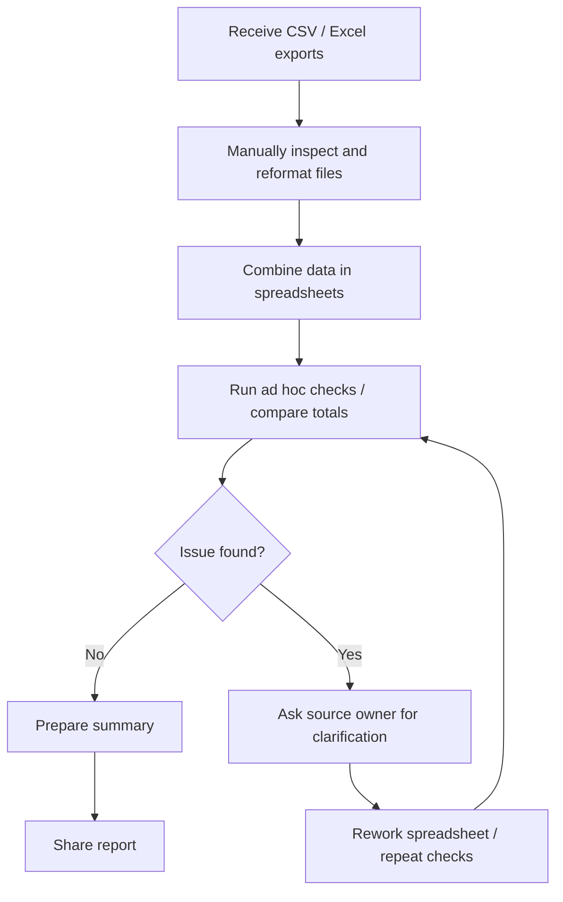
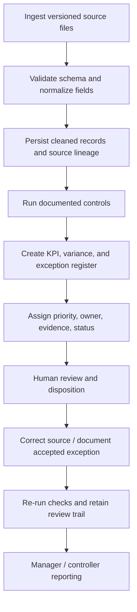

# Process Improvement Case — Transaction Exceptions

> **As-is and to-be flows are hypothesised for this synthetic portfolio exercise.** They are not findings from observing a real finance team.

## Problem hypothesis

When transaction files arrive from multiple sources, manual cleanup and disconnected checks can make it difficult to reproduce the population used in a report, find the source of an exception, and route it to the right owner.

## As-is (hypothesised)

Potential process risks to validate: inconsistent transformations, checks repeated differently by analyst, unclear exception ownership, limited traceability of rule changes, and summary counts disconnected from row-level evidence.

## To-be (proposed)

## Improvement opportunities

| Opportunity | Expected benefit to test | Required control |
|---|---|---|
| Standardised ingestion and normalisation | Reduce avoidable manual reformatting | Preserve source, row count, and rejected-row detail |
| Shared, version-controlled checks | Improve repeatability across reporting cycles | Unit tests and change review for rule updates |
| Account-level reconciliation output | Make variance investigation more targeted | Independent approved control source and finance-defined tolerance |
| Filterable exception report | Reduce time spent locating relevant rows | Show check rationale and key source fields |
| Explicit ownership and disposition (future feature) | Make unresolved issues visible | Status history, due date, reviewer and evidence reference |

## Prioritisation

1. **First:** establish source completeness, normalisation, and reconciliation correctness.
2. **Second:** give exceptions consistent IDs, check names, key evidence fields, and export.
3. **Third:** add owner, aging, disposition, and root-cause categories.
4. **Later:** integrate with a real ticket/workflow system only after access, controls, and user needs are confirmed.

## Validation plan for a real process

Observe at least one end-to-end reporting cycle; map actual inputs, handoffs, wait time, and rework; agree exception categories and materiality with Finance; establish a baseline for effort, aging, repeat defects, and reconciliation timeliness; pilot the standardised workflow with one period; and compare against a comparable prior period while tracking error rates and reviewer feedback.

## Proposed future-state controls

- Reconcile input row counts before and after each transformation.
- Record source file, load timestamp, run identifier, and rule-set version.
- Retain rejected/invalid records with a reason instead of silently discarding them.
- Require an independent control-total source for any real reconciliation conclusion.
- Maintain a human disposition and evidence trail for investigated exceptions.

## Impact statement

This project demonstrates an executable control-and-reporting workflow on synthetic records. Time saved, error reduction, and financial impact are **hypotheses to measure in a pilot**, not benefits already achieved.
